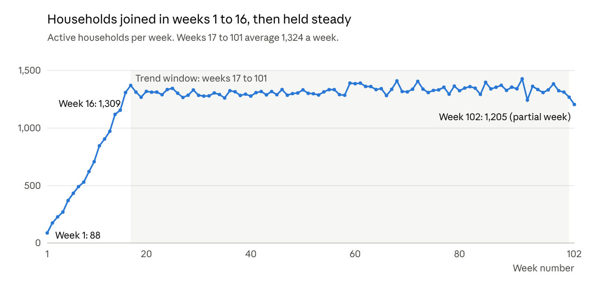

# Retail loyalty analytics: The Complete Journey

Three client-style briefs answered with SQL in BigQuery, using two years of loyalty card data from 2,500 households at a US grocery retailer (dunnhumby's *The Complete Journey*).

Each brief starts from a commercial question a retailer's loyalty team would ask. Each ends with a one-page summary written for a non-technical reader: what we found, what it means, and one recommendation.

## The three briefs

| Brief | The client's question | What we found |
| --- | --- | --- |
| [1. Campaign uplift](briefs/brief1_summary.md) | Did our coupon campaigns make customers spend more than they would have anyway? | No campaign clearly raised spend. Best estimates are $8 to $30 per household, and every 95% range includes zero. |
| [2. Lapsing customers](briefs/brief2_summary.md) | Which regular customers are we losing, and what do they stop buying? | 26% of regulars lapsed or declined, cutting $431,000 of spend that growth elsewhere hid. Decliners halved their visits and dropped fresh produce first. |
| [3. Own-label](briefs/brief3_summary.md) | Is own-label taking sales from branded? | Not overall (21.3% to 21.4% of spend). In paper towels, switchers to own-label bought 23% more but spent 9% less. |


## How the work was checked

- **The first answer to Brief 1 was wrong, and a placebo test caught it.** My first method put campaign uplift at up to $99 per household. Run over a period before any campaign existed, the same method found a $65 "uplift" from nothing. That showed it was picking up regression to the mean, because I had banded households on the same weeks I measured change from. Banding on an earlier 16-week period fixed it: the placebo then showed +$8, not clearly different from zero.
- **The raw data is never edited.** Fixes are applied in a separate cleaned layer, and every decision is recorded with its evidence in [docs/dq_notes.md](docs/dq_notes.md). For example, 40,671 fuel, coupon and placeholder lines (8.5% of sales) are flagged rather than deleted, and 63 floating-point noise values are rounded away without changing total sales by a cent.
- **Trend analysis skips the panel's ramp-up.** Households joined the dataset over the first 16 weeks, which would otherwise look like customers spending more.



## Tools

- **BigQuery** (sandbox) for all SQL: loading checks, profiling, cleaning and the three analyses
- **Python** (`google-cloud-bigquery`) to load the CSVs into BigQuery
- **Power BI** for the dashboard: in progress

## Repository structure

```
retail-loyalty/
├── 01_load_to_bigquery.py          load the CSVs into BigQuery
├── requirements.txt
├── data/                           CSVs go here (not included, see data/README.md)
├── sql/
│   ├── 01_row_counts.sql           check the load
│   ├── 02_profiling.sql            ten data quality checks
│   ├── 03_clean.sql                build and validate the cleaned layer
│   ├── 04_brief1_campaign_uplift.sql
│   ├── 05_brief2_lapsing_customers.sql
│   └── 06_brief3_own_label.sql
├── briefs/
│   ├── brief1_campaign_uplift.md   the question, method and limits
│   ├── brief1_summary.md           one-page client summary
│   ├── brief2_lapsing_customers.md
│   ├── brief2_summary.md
│   ├── brief3_own_label.md
│   └── brief3_summary.md
├── dq_notes.md                 every data quality finding and decision
└── images/                         charts used in the summaries
```

## How to reproduce it

1. Download *dunnhumby - The Complete Journey* from Kaggle and put the CSVs in `data/` (see [data/README.md](data/README.md)).
2. Create a Google Cloud project with BigQuery (the free sandbox is enough) and set `PROJECT_ID` in `01_load_to_bigquery.py`.
3. Install and sign in:
   ```
   pip install -r requirements.txt
   gcloud auth application-default login
   ```
4. Load the data: `python 01_load_to_bigquery.py`
5. Run the files in `sql/` in order in the BigQuery console, replacing `retail-loyalty` with your own project ID.

In the BigQuery sandbox, tables expire after 60 days. Re-running steps 4 and 5 rebuilds everything in a few minutes.

## About the data

- One unnamed US grocery retailer, 2,500 households, about 2.6 million transaction lines over two years.
- Retailer and brand names are anonymised, days and weeks are numbered rather than dated, and money is in US dollars.
- Demographics cover 801 households only, so any demographic finding is labelled as a subset.
- The data is not included in this repository, as its licence does not allow republishing it.
