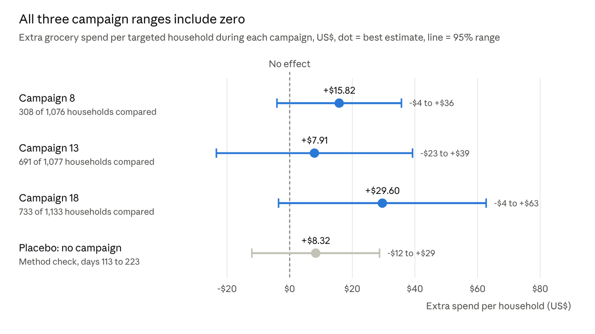

# Brief 1: Did the Coupon Campaigns Work?

Zaid · 25 October 2026

None of the three campaigns clearly raised spend among the households we could measure. Our best estimate is $8 to $30 extra per targeted household per campaign, but every range includes zero.

## The question

Three mailed coupon campaigns (8, 13 and 18) each went to about 1,100 loyalty card households, and redemptions looked healthy. You asked whether they made customers spend more than they would have anyway, and by how much. All figures are grocery spend in US dollars.

## What we found

Every estimate is positive, but every range crosses zero, so we cannot say any campaign raised spend. Campaign 18 comes closest.

- **Couponed products did not clearly sell more.** Campaign 8 came closest at about 15% above its usual level, but its range also included zero.
- **Nothing lasted.** In the weeks after each campaign, spend showed no clear difference from the comparison group.

## Why healthy redemptions mislead

Redemptions mostly came from households that were already big spenders. Before each campaign, redeemers spent about 50% more than targeted households who did not redeem ($510 against $334 for campaign 8).

The offers were also broad. Campaigns 13 and 18 each covered about 35,500 products, around 40% of the range, and campaign 8 about 17,000. Those products were already about half of what targeted households bought. So most coupons are likely to have discounted purchases that would have happened anyway.

The obvious comparison makes this worse. Targeted households outspent everyone else by about $280 to $320 during each campaign, but they were spending 5 to 6 times more before it too. That gap reflects who was picked, not what the mailer did.

## Recommendation

**For the next campaign, hold back a random 10 to 20% of the households selected and send them nothing.**

This gives a like-for-like comparison group, chosen the same way as the people mailed, including the top spenders we could not measure here. The extra spend is then simply what the mailed group bought minus what the held-back group bought. It costs nothing to set up and turns "redemptions looked healthy" into a proven figure.

Campaign 18 is the best candidate to repeat with a holdout. It had the highest estimate, and the only clear result in the analysis: $19 more spent on products that were not on coupon, which suggests the mailer brought people in.

## How we measured it, and the limits

We compared everyone sent each campaign with 914 households never sent any campaign. Extra spend is the change in targeted households' spend from the weeks before to the weeks during the campaign, minus the same change for the comparison group. Households were matched on their usual spend over the previous 16 weeks.

We checked the method on a period before any campaign ran, where the true answer is zero. It found +$8, not clearly different from zero. An earlier version found +$65 there, so it was set aside.

- **The top spenders could not be measured.** Almost no never-contacted households shop at their level. Only 29% of campaign 8's households could be compared, and about 65% for campaigns 13 and 18.
- **The campaigns overlapped.** 732 households received all three, and each campaign's before-weeks include the end of the one before. This makes the estimates lean cautious.
- **The comparison group was not chosen at random.** This is the gap the recommendation closes.
