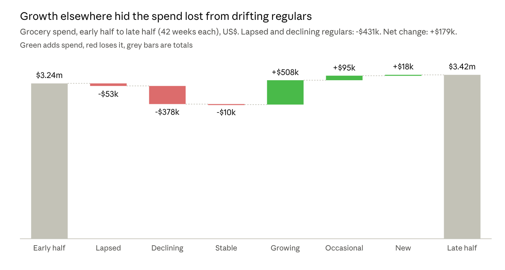

# Brief 2: Which Customers Are We Losing?

Zaid · 25 October 2026

One in four regular households is drifting away. Between the two halves of the period they cut $431,000 of spend, hidden by growth elsewhere. Most of it comes from households that still shop but have halved their visits.

## The question

The loyalty base looks steady week to week, but you suspected some regular customers were drifting away. You asked who they are, what it costs, and what they buy less of.

We compared each household's grocery spend in two equal halves of 42 weeks: the early half (weeks 18 to 59) and the late half (weeks 60 to 101). Each half includes one holiday peak. All figures are in US dollars.

## What we found

Total spend rose 5.5%, but that hides 537 regular households (26% of regulars) who lapsed or declined.

- **Declining households carry the loss.** 450 households lost $378,000, against $53,000 from the 87 that lapsed.
- **They were proper regulars.** They made 61 trips in the early half, the same as stable households, then 32 in the late half.
- **They come in less often rather than buying less per trip.** Spend per trip fell only from $26.56 to $24.00, which suggests some trips moved to another store.

## What drifting households stop buying

It is a whole-shop problem, not one weak department. Declining households cut 50 to 54% in each of the six biggest departments, while stable households moved by 4% or less. Grocery accounts for 56% of the decline simply because it is 56% of what these households buy.

They also drop whole categories. Declining households stopped buying 45% of the categories they used to buy, against 26% for stable households. Fresh produce stands out: 8 of the 15 categories with the biggest gap are produce.

| Category | Declining households that stopped buying it | Stable households that stopped buying it |
| --- | --- | --- |
| Apples | 47% | 18% |
| Carrots | 53% | 24% |
| Stone fruit | 57% | 23% |
| Mushrooms | 59% | 26% |
| Smoked meats | 60% | 30% |

Produce is where shoppers judge a store's quality, and it is often the first thing they buy elsewhere. This data shows what was dropped, not why, so treat it as a strong lead rather than a proven cause.

## Who is drifting

The clearest pattern is income. Among households earning under $15,000 a year, 28% are drifting, almost double the 15% average for households with demographic data. Together with the produce finding, this fits price-sensitive households moving trips to a cheaper store, but the data cannot confirm that.

Younger households (aged 19 to 24) and single parents also drift more often, at 20 to 22%, but these groups have under 50 households each, too few to be sure.

This section covers only the 785 regular households that gave demographic details. They drift less than regulars overall (15% against 26%), so the pattern by type is a guide, not a precise rate.

## Recommendation

**Flag regular households whose visits fall by 30% or more, and reach them while they are still shopping.**

Declining households lost seven times more spend than lapsed ones ($378,000 against $53,000), and they are still coming in, so they can still be reached. A fresh produce offer is the natural first test, given what they drop first.

Send it to a random 80 to 90% of flagged households and hold back the rest. Without a held-back group, as Brief 1 showed, there is no way to prove the offer worked. Every 10% of the decline won back is worth about $38,000 over 42 weeks.

## How we measured it, and the limits

| Segment | Rule |
| --- | --- |
| Lapsed | A regular in the early half, with no purchase in the last 12 weeks |
| Declining | Still shopping, but late-half spend under 70% of the early half |
| Stable | Late-half spend between 70% and 130% of the early half |
| Growing | Late-half spend over 130% of the early half |
| Occasional | Fewer than 10 trips in the early half, so too few to call a trend |

Weeks 1 to 17 were left out because households were still joining the scheme. The 12-week and 30% thresholds are judgement calls.

- **Leaving the scheme looks the same as lapsing.** A household that stopped using its card or moved away cannot be told apart from one that switched store.
- **Some movement is noise.** One unusually big early half can make a household look like it is declining.
- **This describes, it does not explain.** It shows who is drifting and what they drop, not why.
