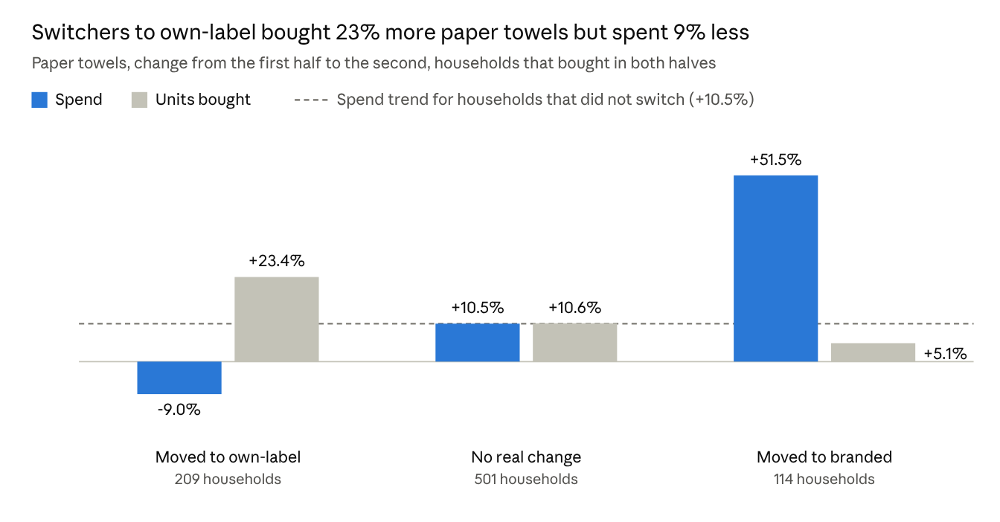

# Brief 3: Is Own-Label Taking Sales from Branded?

Zaid · 25 October 2026

Not overall: own-label held steady at about 21% of grocery spend. It does move category by category, slightly more where brands cut their promotions. In paper towels, where it gained most, households that switched bought 23% more but spent 9% less.

## The question

You have been pushing the own-label range, and asked whether it is taking sales from branded products, in which categories, and whether shoppers who switch spend more or less with you.

We compared grocery spend in two equal halves of 42 weeks: weeks 18 to 59 and weeks 60 to 101. All figures are in US dollars.

## Across categories

Own-label was 21.3% of grocery spend in the first half and 21.4% in the second. Across the 63 categories where both own-label and branded have a real presence, 34 gained share and 28 lost, with an average change of +0.1 points. Own-label was about 22% cheaper per unit on average, but price alone did not move shoppers.

The biggest moves line up with branded promotions:

| Category | Own-label share change | Branded spend on discount, first to second half |
| --- | --- | --- |
| Paper towels | +8.1 points | 19% to 14% |
| Frozen potatoes | +4.2 points | 23% to 9% |
| Shelf-stable vegetables | +2.9 points | 21% to 15% |
| Dog food | -3.3 points | 13% to 16% |
| Nappies | -2.9 points | 5% to 8% |
| Coffee | -2.4 points | 8% to 10% |

Across all 63 categories the link is real but weak (correlation -0.25). Where branded discounting fell, own-label gained 0.3 points on average. Where it rose, own-label lost 0.3 points. Promotions explain part of the movement, not most of it.

## Deep dive: paper towels

Own-label's biggest gain was in paper towels. Shoppers who switched to it bought more for less, so the retailer sold more rolls but took less money.

- **More households moved to own-label than away from it:** 209 against 114, out of 1,522 that bought paper towels. That is what lifted own-label's share.
- **Switchers to own-label paid much less per unit**, $1.69 against $2.29 before. Their spend ended about 18% below the trend of households that did not switch.
- **Switchers to branded went the other way:** they bought 5% more but spent 52% more.
- **Many shoppers came and went.** 323 households stopped buying paper towels here and 375 started, so the category's buyers turn over quickly.

## Recommendation

**Before moving promotion money away from brands in a category, check that own-label's margin covers the lost sales.**

In paper towels, switchers' spend ended about 18% below where the category trend would have put it. For that to break even, own-label needs to earn roughly 21% more per dollar of sales than branded. For example, if branded earns 25 cents per dollar, own-label needs about 30 cents.

Own-label often clears that bar, but only your finance team holds the margin figures. The same check, run category by category, shows where pushing own-label pays and where it only shrinks the till.

## How we measured it, and the limits

Categories were compared only where they had at least $10,000 of spend in the first half and both own-label and branded held at least 10% of it. In paper towels, a household counts as switching when its own-label share moved by 20 points or more between the halves.

- **There is no margin data.** This measures sales, not profit, which is why the recommendation is a check rather than a verdict.
- **Price per unit is rough.** Categories mix pack sizes, so per-unit prices compare averages, not like-for-like products. Paper towels' -75% price gap is probably distorted this way.
- **This shows what changed, not why.** The promotion link is consistent but weak, and other factors such as range or shelf space are not in the data.
